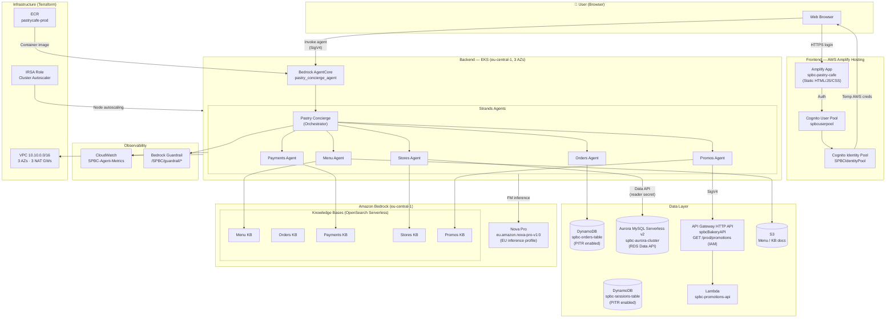
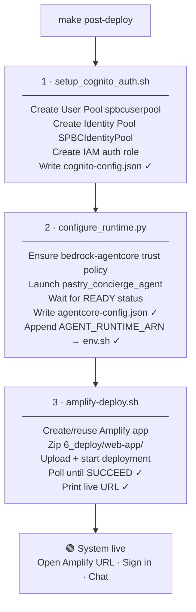

# 🥐 Specialty Bakeries & Pastry Cafés — Production Deployment

Production AWS deployment pipeline for the **Specialty Bakeries & Pastry Cafés** AI Concierge —
a multi-agent GenAI application built on Amazon Bedrock AgentCore and deployed to `eu-central-1` (Frankfurt).

---

## Architecture



---

## System components

| Layer | Component | AWS Resource | Name |
|---|---|---|---|
| Frontend | Web app | AWS Amplify Hosting | `spbc-pastry-cafe` |
| Auth | User Pool | Amazon Cognito | `spbcuserpool` |
| Auth | Identity Pool | Amazon Cognito | `SPBCIdentityPool` |
| Agent runtime | Orchestrator | Bedrock AgentCore | `pastry_concierge_agent` |
| Compute | EKS cluster | Amazon EKS | `pastrycafe-prod` |
| Compute | Container registry | Amazon ECR | `pastrycafe-prod` |
| Data | Orders store | DynamoDB (PITR) | `spbc-orders-table` |
| Data | Sessions store | DynamoDB (PITR) | `spbc-sessions-table` |
| Data | Store locations | Aurora MySQL Serverless v2, read through the RDS Data API (`6_deploy/infra/agentcore-backends`) | `spbc-aurora-cluster`, read-only secret `spbc-stores-db-reader` |
| Data | Promotions API | API Gateway HTTP API (IAM auth) + Lambda (`6_deploy/infra/agentcore-backends`) | `spbcBakeryAPI`, `GET /prod/promotions` |
| Data | KB documents | S3 + OpenSearch | `spbc-input-docs-bucket-*` |
| AI | Foundation model | Amazon Bedrock | Nova Pro via EU inference profile `eu.amazon.nova-pro-v1:0` (no in-Region on-demand in eu-central-1) |
| Security | Content guardrail | Bedrock Guardrail | `/SPBC/guardrail/*` (SSM) |
| Observability | Metrics dashboard | CloudWatch | `SPBC-Agent-Metrics` |
| IaC state | Remote state | S3 (EKS stack: DynamoDB lock; agentcore-backends: S3 lock file) | `spbc-tfstate-eu-central-1` |

---

## Deployment pipeline

```mermaid
flowchart LR
    S1["① make backend-setup\n────────────────\n• Create S3 state bucket\n• Create DynamoDB lock\n• Auto-detect outbound IP\n• Write terraform.tfvars"]
    S2["② make ci\n────────────────\n• Python compileall\n• terraform fmt + validate\n• terraform test (backends)"]
    S3["③ make provision\n────────────────\n• VPC · 3 AZs · NAT GWs\n• EKS cluster\n• ECR repo\n• DynamoDB tables\n• IRSA role\n• Cluster Autoscaler"]
    S3B["③b make backends\n────────────────\n• Aurora Serverless v2\n  + Data API\n• Promotions HTTP API\n• make seed-stores\n• make backends-check"]
    S4["④ export ECR_URL\n────────────────\n• terraform output\n  ecr_repository_url"]
    S5["⑤ make deploy\n────────────────\n• Docker build + push\n• Blue/green rollout\n• Smoke test"]
    S6["⑥ make post-deploy\n────────────────\n• Cognito setup\n  → cognito-config.json\n• AgentCore launch\n  → agentcore-config.json\n• Amplify deploy"]
    LIVE["🟢 LIVE\n────────────────\nhttps://main.<app>.amplify.app"]

    S1 --> S2 --> S3 --> S3B --> S4 --> S5 --> S6 --> LIVE
```



---

## First-time deployment

### Step 1 — Backend setup *(run once)*

Creates the S3 Terraform state bucket, the DynamoDB lock table, and writes `terraform.tfvars`
with your current outbound IP as `eks_public_access_cidrs` — so the EKS API server is never world-accessible.

```bash
make backend-setup
```

To also allow a CI/CD runner IP:

```bash
bash 6_deploy/scripts/terraform_backend_setup.sh --extra-cidr <CI_RUNNER_IP>/32
```

> **`terraform.tfvars` is gitignored** — it contains your IP. Never commit it.

### Step 2 — Local validation

```bash
make ci
```

Runs `python3 -m compileall` on the Python code, `terraform fmt -check` + `terraform validate` on both
Terraform stacks, and the mocked `terraform test` suite of `6_deploy/infra/agentcore-backends` (no AWS calls).

### Step 3 — Provision infrastructure

```bash
make provision
```

Applies the Terraform plan. Creates:

| Resource | Detail |
|---|---|
| VPC | `10.10.0.0/16`, 3 private + 3 public subnets, one NAT GW per AZ |
| EKS | `pastrycafe-prod` v1.29, 1–3 × `t3.medium` nodes |
| ECR | `pastrycafe-prod` with image scanning on push |
| DynamoDB | `spbc-orders-table` + `spbc-sessions-table` (PAY_PER_REQUEST, PITR enabled) |
| IAM | IRSA role `pastrycafe-cluster-autoscaler` (OIDC-federated, scoped to cluster tag) |
| Helm | Cluster Autoscaler 9.37.0 via `kube-system` |
| ACM + Route 53 | Only when `route53_zone_id` is set — skipped by default |

After provisioning, export the ECR URL for the deploy step:

```bash
export ECR_REPOSITORY_URL=$(terraform -chdir=6_deploy/infra/terraform output -raw ecr_repository_url)
```

### Step 3b — AgentCore backends *(stores database + promotions API)*

A separate Terraform stack, [6_deploy/infra/agentcore-backends](6_deploy/infra/agentcore-backends), with its own
state (`prod/agentcore-backends.tfstate`). It needs Terraform 1.10+.

```bash
make backends                    # plan → confirm → apply exactly that plan
make seed-stores                 # create StoresDB.stores, load 2_data_strategy/stores, create the read-only user
make backends-check              # reader query, unsigned request rejected (403), signed GET /promotions
eval "$(make -s backends-env)"   # STORES_DB_* + PROMOS_API_URL for configure_runtime.py (setup_env.sh discovers them too)
```

| Resource | Detail |
|---|---|
| Aurora MySQL Serverless v2 | `spbc-aurora-cluster`, 2 instances (Multi-AZ), 0.5–4 ACU, encrypted, TLS required, 7-day backups, deletion protection, final snapshot, RDS Data API |
| Credentials | RDS-managed master secret (loader only); read-only `stores_reader` in `spbc-stores-db-reader` (agents) |
| Network | Isolated VPC (private subnets, no IGW/NAT, flow logs); no inbound rule on the database |
| Promotions API | HTTP API `spbcBakeryAPI`, `GET /promotions` with IAM auth, stage `prod` (throttled, access logs) → Lambda serving today's promotions from `2_data_strategy/promos/promos_records.json` |
| Outputs | `agentcore_runtime_env` (the 4 runtime env vars), `agentcore_runtime_backends_policy_json` (execution-role policy) |

Settings live in `6_deploy/infra/agentcore-backends/terraform.tfvars` (see `terraform.tfvars.example`), for example
`aurora_instance_count = 1` and `aurora_min_acu = 0` (auto-pause) for non-production. `configure_runtime.py` passes the
four env vars to the runtime and attaches the `SPBC-AgentCore-Backends` inline policy to its execution role.

Then run `source setup_env.sh`: it writes the four values into `~/environment/env.sh`, which `make post-deploy` loads.
`make post-deploy` skips the AgentCore launch when `agentcore-config.json` already holds a runtime ARN, so for an
existing runtime apply the new settings with `cd 6_deploy/agents && python3 configure_runtime.py`.

### Step 4 — Deploy the agent backend

```bash
make deploy
```

Builds the web image ([6_deploy/web-app/Dockerfile](6_deploy/web-app/Dockerfile)), pushes it to
ECR, performs a **blue/green Kubernetes rollout**, and runs the smoke test.

Internally runs:

```
end_to_end.sh --deploy-only
  └─ deploy_blue_green.sh   (deploys the idle colour, then moves the Service to it)
  └─ smoke_test.sh          (asserts the served page is this app)
```

The Service selects one colour at a time. A deploy goes to whichever colour is *not* live and
moves production only once the new pods are healthy, so a failed rollout leaves traffic where it
was. The previous colour keeps running, and the previous colour and image are recorded as
annotations on the Service.

To roll back after a bad release:

```bash
bash 6_deploy/scripts/rollback.sh --status   # what is live, and what it would roll back to
make rollback                                # switch back to the recorded previous colour
```

Rollback refuses to move traffic to a colour with no ready replicas — pointing the Service at an
empty colour would be an outage, not a rollback. Images are tagged per build (commit SHA or
timestamp); `IMAGE_TAG=latest` is rejected unless `ALLOW_MUTABLE_TAG=1`, because a mutable tag
leaves no known-good image to return to.

### Step 5 — Post-deploy *(Cognito + AgentCore + Amplify)*

```bash
make post-deploy
```

This **single command** completes the system end-to-end — no manual steps:



The script is **idempotent** — each sub-step checks whether the config file is already
populated before re-running, so it is safe to re-run after partial failures.

---

## Unattended deployment

Every step below runs without a terminal: nothing prompts, and each stage fails loudly rather
than skipping work or guessing a value.

```bash
# 1. Terraform state + an explicit EKS API allowlist (never auto-detected in a pipeline:
#    a build agent's address changes between runs, and detection failure is a hard error,
#    not a fallback to 0.0.0.0/0)
EKS_PUBLIC_ACCESS_CIDRS="203.0.113.10/32" make backend-setup

# 2. Validation, infrastructure, agent image
make ci
make provision                       # requires terraform.tfvars from step 1; -input=false
export ECR_REPOSITORY_URL=$(terraform -chdir=6_deploy/infra/terraform output -raw ecr_repository_url)
make deploy

# 3. Data backends and knowledge bases
AUTO_APPROVE=1 make backends         # Aurora + promotions API, applies the reviewed plan
make seed-stores
make backends-check
source setup_env.sh                  # discovers buckets, KBs, STORES_DB_*, PROMOS_API_URL
make knowledge-bases                 # vector store + all five KBs, each sync verified

# 4. Cognito, AgentCore runtime, frontend
export COGNITO_ADMIN_USERNAME=concierge
export COGNITO_ADMIN_PASSWORD_SECRET_ID=spbc/cognito-admin   # or --skip-user
make post-deploy-force               # --force: plain post-deploy skips the launch when a runtime exists

# 5. Verify
SMOKE_TEST_URL=https://main.<app-id>.amplifyapp.com make smoke
./deploy_agentcore.sh step9-test-runtime   # asserts each domain's answer, not just HTTP 200
```

Behaviour that matters when nobody is watching:

| Concern | How it behaves |
|---|---|
| Sign-in user | From `COGNITO_ADMIN_USERNAME` + `COGNITO_ADMIN_PASSWORD_SECRET_ID` (Secrets Manager) or `COGNITO_ADMIN_PASSWORD`; `SKIP_USER_CREATION=1` to create none. With no terminal and none of these, the script stops instead of waiting on stdin. |
| EKS API allowlist | `--cidr` / `EKS_PUBLIC_ACCESS_CIDRS`. `0.0.0.0/0` is refused unless `--allow-open` is passed; failed IP detection is an error. |
| Re-deploying agent code | `make post-deploy-force` or `FORCE_REDEPLOY=1`. Without it a populated `agentcore-config.json` makes the launch a no-op, and the run says so. |
| Knowledge bases | Idempotent; an ingestion job that scans zero documents or fails one fails the run. |
| Terraform | `-input=false` everywhere; `make backends` needs `AUTO_APPROVE=1` to skip its confirmation. |
| Frontend check | `SMOKE_TEST_URL` is required and the body must contain the app's title, so a 200 from a holding page fails. |
| Agent check | `step9-test-runtime` matches each domain's answer against an expected pattern and rejects "Sorry, I encountered an error"-style replies. Domains whose backend isn't configured degrade to warnings. |

### Running it from CI

That sequence runs on AWS — CodeCommit + CodePipeline (V2) + CodeBuild, no stored AWS keys and
no account IDs in the pipeline. The source lives in a CodeCommit repo; a push to `main` drives
the pipeline through four stages: **Source → Validate → Approve → Deploy**. Validate runs
`make ci`; Deploy runs [6_deploy/codepipeline/buildspec-deploy.yml](6_deploy/codepipeline/buildspec-deploy.yml),
which maps the deploy steps onto the same scripts. The stack and operator walkthrough live in
[6_deploy/infra/codepipeline/README.md](6_deploy/infra/codepipeline/README.md).

The slow, billable stages stay opt-in as pipeline variables, surfaced to the Deploy build as
CodeBuild environment variables:

| Toggle | Default | Purpose |
|---|---|---|
| `TOGGLE_PROVISION_BACKENDS` | `false` | Apply and seed the AgentCore data backends |
| `TOGGLE_SETUP_KNOWLEDGE_BASES` | `false` | Bootstrap the vector store and knowledge bases |
| `TOGGLE_DEPLOY_AGENT` | `true` | Deploy the AgentCore runtime + frontend |
| `TOGGLE_DEPLOY_EKS` | `false` | Build the web image and run the blue/green EKS rollout |
| `TOGGLE_SMOKE` | `false` | Run the frontend smoke test (only when `SMOKE_TEST_URL` is also set) |

`COGNITO_ADMIN_USERNAME` + `COGNITO_ADMIN_PASSWORD_SECRET_ID` create the sign-in user; without
both the Deploy build passes `--skip-user`. The **Approve** stage is a manual approval action
that pauses the pipeline and notifies the `spbc-pipeline-approvals` SNS topic — approve from the
console or with `aws codepipeline put-approval-result`. Images are tagged with the commit SHA,
never `latest`.

---

## Day-2 operations

| Command | When to use |
|---|---|
| `make amplify` | Re-deploy only the frontend after UI changes |
| `make post-deploy` | Re-run Cognito / AgentCore / Amplify after any config change |
| `make smoke` | Verify the live endpoint (set `SMOKE_TEST_URL` env var first) |
| `make rollback` | Switch production traffic back to the previously live colour (refuses if that colour has no healthy pods) |
| `bash 6_deploy/scripts/rollback.sh --status` | Show which colour is live, the rollback target, and ready replicas per colour |
| `bash 6_deploy/scripts/terraform_backend_setup.sh --extra-cidr <IP>/32` | Add a new CI/CD runner IP to `eks_public_access_cidrs` |
| `make backends-plan` / `make backends` | Review and apply backend changes (for example after editing `promos_records.json`: the Lambda function is rebuilt) |
| `make seed-stores` | Reload the stores data, or re-sync `stores_reader` after rotating its secret (idempotent) |
| `make backends-check` | Prove the stores database and promotions API answer the way the runtime calls them |
| `make knowledge-bases` | Create or re-sync the vector store and all five knowledge bases (idempotent) |
| `bash 3_proof_of_concept/knowledge_bases/setup_knowledge_bases.sh <domain>` | Re-sync one knowledge base after editing its source document |
| `make post-deploy-force` | Ship changed agent code (plain `post-deploy` skips the launch when a runtime already exists) |
| `make help` | Print all available targets with descriptions |

---

## Repository layout

```
.
├── 1_business_modeling/        Business value model (EUR)
├── 2_data_strategy/            Seed data — menu, stores, orders, promos
│   └── stores/load_stores_data_api.py   Stores loader through the RDS Data API (make seed-stores)
├── 3_proof_of_concept/         PoC agents + knowledge-base setup scripts
│   └── knowledge_bases/
│       ├── bootstrap_vector_store.sh    OpenSearch Serverless collection, policies, KB service role
│       ├── setup_knowledge_bases.sh     All five KBs, idempotent, each sync verified
│       ├── kb_common.sh                 Shared helpers used by the above
│       └── <domain>_knowledge_base_setup.sh   Per-domain scripts (menu, orders, payments, stores, promos)
├── 4_monitor_and_evaluate/     CloudWatch observability scripts
├── 5_security_rai/             Bedrock Guardrail creation + SSM storage
├── 6_deploy/
│   ├── agents/                 Production agent code (Strands + AgentCore)
│   │   ├── barista_supervisor_agent.py   Pastry Concierge orchestrator (entrypoint)
│   │   ├── menu_agents.py
│   │   ├── orders_agents.py
│   │   ├── payments_policy_agents.py
│   │   ├── stores_agents.py
│   │   ├── promos_agents.py
│   │   ├── place_order.py
│   │   ├── configure_runtime.py          Launches AgentCore + writes configs
│   │   ├── Dockerfile                    linux/arm64 runtime image (console/CLI container path)
│   │   ├── requirements.txt              Pinned runtime dependencies (shipped to AgentCore)
│   │   └── requirements-deploy.txt       + starter toolkit, for running configure_runtime.py
│   ├── infra/terraform/        Terraform IaC (VPC, EKS, ECR, DynamoDB, IRSA)
│   ├── infra/agentcore-backends/  Terraform: Aurora stores DB (Data API) + promotions API (+ optional orders table)
│   │   ├── lambda/promotions/handler.py  GET /promotions (today's promotions)
│   │   └── tests/backends.tftest.hcl     Mocked plan/apply tests (terraform test)
│   ├── k8s/                    Kubernetes manifests (namespace, service, ingress)
│   │                           Per-colour Deployments are generated by deploy_blue_green.sh
│   ├── scripts/
│   │   ├── terraform_backend_setup.sh   ← Step 1 (make backend-setup)
│   │   ├── end_to_end.sh                ← Steps 3–4 (make provision / deploy)
│   │   ├── agentcore_backends.sh        ← Step 3b (make backends / seed-stores / backends-check)
│   │   ├── deploy_blue_green.sh
│   │   ├── post_deploy.sh               ← Step 5 (make post-deploy)
│   │   ├── amplify-deploy.sh
│   │   ├── setup_cognito_auth.sh
│   │   ├── smoke_test.sh
│   │   └── rollback.sh
│   └── web-app/                Static frontend (HTML/JS/CSS)
├── amplify.yml                 Amplify build spec
├── Makefile                    All deployment targets
├── setup_env.sh                Discovers + exports AWS resource IDs
└── check_env.sh                Validates environment before deploy
```

---

## Pre-deploy checklist

Before running `make provision` for the first time, verify:

- [ ] `aws sts get-caller-identity` succeeds with the correct account
- [ ] `make backend-setup` has been run (creates state bucket + writes `terraform.tfvars`, including the required `eks_public_access_cidrs`)
- [ ] `make knowledge-bases` has been run, or the five KB IDs are already in `~/environment/env.sh`
- [ ] Nova Pro answers through the EU inference profile (listing foundation models isn't enough — the bare `amazon.nova-pro-v1:0` ID can't be invoked on-demand in eu-central-1):
  `aws bedrock-runtime converse --region eu-central-1 --model-id eu.amazon.nova-pro-v1:0 --messages '[{"role":"user","content":[{"text":"Reply with OK"}]}]'`
- [ ] `ECR_REPOSITORY_URL` is exported (after Step 3)
- [ ] `make backends-check` passes and `STORES_DB_CLUSTER_ARN`, `STORES_DB_SECRET_ARN`, `PROMOS_API_URL` are exported (after Step 3b)
- [ ] Knowledge-base IDs are in `~/environment/env.sh` (required by `configure_runtime.py`)

---

## Notes

- **Region:** `eu-central-1` (Frankfurt) — all resources
- **Currency:** all prices in Euros (€)
- **EKS API access:** restricted to your IP via `eks_public_access_cidrs` — never `0.0.0.0/0`
- **Secrets:** `terraform.tfvars`, `cognito-config.json`, `agentcore-config.json` are gitignored — never commit them
- **EKS NAT HA:** one NAT GW per AZ — a single AZ failure does not take down agent egress
- **Stores DB access:** the agents use the RDS Data API with a SELECT-only user, so the AgentCore runtime needs no VPC path to Aurora; the master secret is only used by the loader
- **Promotions API:** IAM-authorized (SigV4); unsigned requests get 403. Edit `2_data_strategy/promos/promos_records.json` and `make backends` to change promotions
- **Backends teardown:** `bash 6_deploy/scripts/agentcore_backends.sh apply -var aurora_deletion_protection=false`, then `... destroy` (guarded; keeps the final snapshot)
- **`deploy_frontend.sh`** (EKS + CloudFront VPC Origin path) is retained for reference — the primary frontend path is `make amplify`
