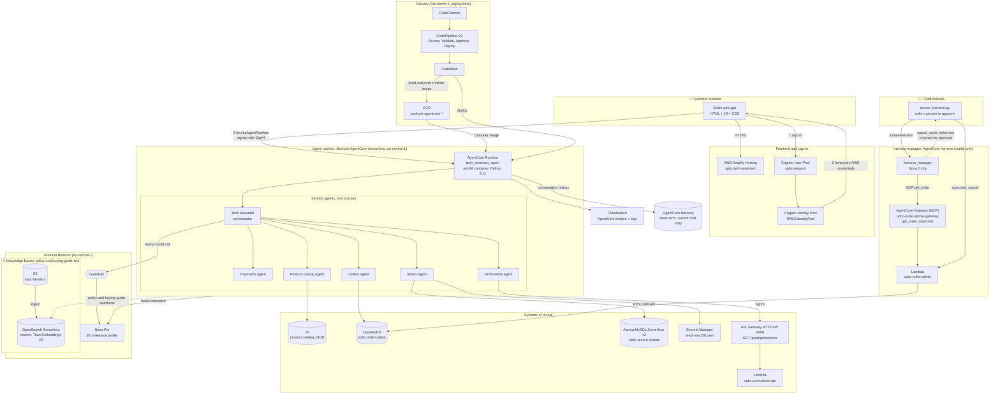
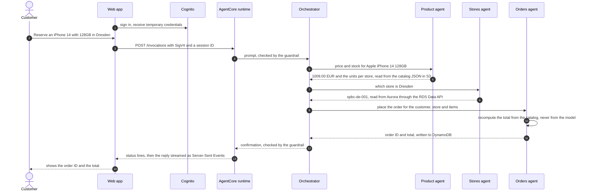
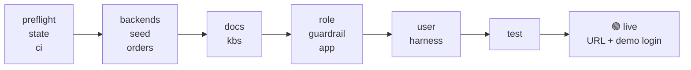

# 📱 Cyberport Tech Assistant — Production Deployment

Production AWS deployment pipeline for the **Cyberport Tech Assistant** — a multi-agent GenAI
shopping and service assistant for an electronics retailer, built on Amazon Bedrock AgentCore and
deployed to `eu-central-1` (Frankfurt).

> **Client project for Cyberport.** Until it is connected to Cyberport's systems it runs on sample
> data: the smartphone and laptop catalog comes from public Kaggle datasets (PcComponentes prices in
> €, Apache 2.0); stores, stock, orders, promotions and policies are sample content. See
> [2_data_strategy/SOURCES.md](2_data_strategy/SOURCES.md).

> **Deploy in one command:** `./deploy.sh`. Step-by-step runbook, troubleshooting and tear down: [DEPLOY.md](DEPLOY.md).

## What it does

One orchestrator (the Tech Assistant) routes each customer question to five specialist agents, each
reading its own system of record:

| Agent | Answers | System of record |
|---|---|---|
| Product catalog | Specs, comparisons, recommendations, prices per storage size, stock per store | Catalog JSON in S3 + buying-guide KB |
| Orders | Click & collect orders, order status (needs customer ID **and** order ID), delivery, returns, warranty | DynamoDB `spbc-orders-table` + orders KB |
| Payments | Payment methods, 0% financing, refunds, invoices, gift cards | Payments KB |
| Stores | Locations, opening hours, pickup stations, repair desk, recycling | Aurora `StoresDB.stores` (read-only) + stores KB |
| Promotions | Trade-in bonus, student and business discounts, Black Friday | Promotions API (IAM); the Lambda behind it reads the promotions file in S3 (no knowledge base) |

Example questions:

```
Catalog   → "Which laptop under €1,000 is best for a student?"
Stock     → "Is the Apple iPhone 14 in stock at the Cyberport Store Dresden?"
Orders    → "What is the status of order ord_2055_023 for customer_2055?"
Payments  → "Can I pay for a laptop in instalments?"
Stores    → "What are the opening hours in Berlin?"
Promos    → "How does the trade-in bonus work?"
```

Order totals are always recomputed from the catalog inside `place_order`, never taken from the
model, and order lookups require both the customer ID and the order ID.

---

## Technology stack

| Layer | Technology | Notes |
|---|---|---|
| Frontend | Static HTML, CSS and JavaScript, no build step | `6_deploy/web-app`; hosted on **AWS Amplify**. Libraries come from a CDN: `amazon-cognito-identity-js` 6.3.7 and AWS SDK for JavaScript 2.1563.0 |
| Sign-in | **Amazon Cognito** user pool + identity pool | The browser exchanges the sign-in for temporary AWS credentials and signs each request with SigV4 |
| Agent runtime | **Amazon Bedrock AgentCore Runtime** | One linux/arm64 container (`python:3.11-slim`), built on CodeBuild with `bedrock-agentcore-starter-toolkit` 0.3.14; the runtime requires MMDSv2 |
| Agent framework | **Strands Agents** 1.62.0, `strands-agents-tools` 0.8.10, `bedrock-agentcore` 1.24.2 | "Agents as tools": one orchestrator calls five specialist agents as in-process tools |
| Model | **Amazon Nova Pro** through the EU inference profile `eu.amazon.nova-pro-v1:0`; **Amazon Nova 2 Lite** for harness-manager | The bare model IDs cannot be invoked on-demand in eu-central-1. harness-manager uses Nova 2 Lite because Nova Pro produced invalid tool-use sequences with the gateway's MCP tools |
| Streaming | Server-Sent Events from the runtime (`"stream": true` in the payload) | The web app shows progress lines while tools run, then the answer as it is written. Without the flag the runtime returns JSON (tests, CLI) |
| Memory | **AgentCore Memory**, short-term only | The current conversation, so follow-ups such as "is it in stock?" work. No long-term memory across chats: recalled old chats made answers drift |
| Staff agent | **AgentCore harness** `harness_manager` + **AgentCore Gateway** (MCP) + Lambda | Config-defined agent (no code, no container). Reads orders through the gateway; cancellation is an inline tool that a person must approve |
| Retrieval | **Bedrock Knowledge Bases** (5) on **OpenSearch Serverless** | Titan Text Embeddings V2 (1024 dimensions), HNSW/faiss index, hybrid search returning 7 results; source documents in S3 |
| Data | **DynamoDB** (orders), **Aurora MySQL Serverless v2** (stores), **S3** (catalog JSON, KB documents) | Aurora is read through the **RDS Data API** with a SELECT-only user (no VPC path from the runtime) |
| Business API | **API Gateway HTTP API** (IAM auth) + **Lambda** (Python 3.12, arm64) | Serves today's promotions; the promotions agent calls it with SigV4 |
| Safety | **Bedrock Guardrails**, IAM least privilege, **Secrets Manager**, **SSM Parameter Store** | Content filters including prompt-attack detection, denied topics, PII masking and blocking; the guardrail ID and version live in SSM |
| Infrastructure as code | **Terraform** `>= 1.10`, AWS provider `~> 5.100` | Two stacks (`agentcore-backends`, `codepipeline`), remote state in S3 with a lock file |
| Service setup | Bash and Python scripts | Knowledge bases, guardrail, AgentCore runtime, Cognito and Amplify are created by idempotent scripts, not Terraform |
| CI/CD | **CodeCommit**, **CodePipeline** V2, **CodeBuild** (`amazonlinux2-x86_64-standard:5.0`) | Source, Validate (`make ci`), manual Approve, Deploy |
| Observability | **CloudWatch** generative AI observability and Logs, OpenTelemetry (`aws-opentelemetry-distro`) | AgentCore publishes runtime metrics (`AWS/Bedrock-AgentCore`), logs and traces |
| Tests | `make ci` (offline), `make eval` (42 answer checks), `make e2e` (customer journey + staff cancellation), `make browser-test` (headless browser, streaming) | The last three run against the live deployment in `6_deploy/eval/` |
| Data and analysis tooling | Python, `pandas` (catalog builder), **Streamlit** (value model) | `pip install pandas` to run `2_data_strategy/build_from_kaggle.py`, `pip install streamlit` then `streamlit run 1_business_modeling/business_value.py` for the value model; neither is part of the runtime |

---

## Architecture



The dashed line is the knowledge-base lookup. Every specialist can use it, but only for policy and
buying-guide questions, after the live data tools have been tried.

### One request, end to end

A click & collect order, from the first message to the confirmation:



### Design decisions

- **One runtime, six agents.** The specialists are tools inside one process, so agent-to-agent calls are function calls, not network hops, and there is a single container to build, version and scale.
- **No server between the browser and the agents.** The page is static; the browser holds temporary Cognito credentials and calls AgentCore directly, so there is no API layer to run or secure.
- **Facts come from data, language comes from the model.** Prices, stock, orders, hours and promotions are read from their systems of record by tools. Knowledge bases hold only policy and buying-guide text, so the model cannot invent a price.
- **Totals are computed in code.** `place_order` recomputes the total from the catalog and ignores any number the model supplies. Order lookups need both the customer and the order ID.
- **Aurora through the RDS Data API.** The runtime reaches the stores database over HTTPS with IAM, so it needs no VPC attachment, connection pool or database password, and it uses a SELECT-only user.
- **The promotions API is a real business API.** It sits behind IAM authorization and a Lambda function that reads the promotions file from S3, which shows how an agent calls an existing service rather than a database.
- **Terraform for stable infrastructure, scripts for the rest.** The database, API, tables and pipeline are Terraform; knowledge bases, the guardrail and the runtime are created by idempotent scripts that can be re-run safely.
- **Policy decisions in code.** Whether an order can be cancelled (`check_cancellation`: only PROCESSING orders) and which return rule applies (`return_policy`: online or in-store purchase) are decided by tools, not by prompt wording.
- **A person approves every cancellation.** harness-manager can read orders through the gateway, but `cancel_order` is an inline tool: the harness hands the call back to the staff console, which cancels only after a "y". The approver's AWS identity is written to the order. Only orders that are still PROCESSING can be cancelled; once an order has moved further (ready for pickup, shipped, delivered, collected) harness-manager does not cancel it and hands it over to the team with a short handoff note, and the order-admin Lambda refuses the cancellation as well.
- **Human approval before production.** The pipeline pauses at a manual approval before it deploys.

---

## System components

The AWS resources and the names they are created with.

| Layer | Component | AWS Resource | Name |
|---|---|---|---|
| Frontend | Web app | AWS Amplify Hosting | `spbc-tech-assistant` |
| Auth | User Pool | Amazon Cognito | `spbcuserpool` |
| Auth | Identity Pool | Amazon Cognito | `SPBCIdentityPool` |
| Agent runtime | Orchestrator + 5 specialists (one runtime) | Bedrock AgentCore (container artifact, built by CodeBuild) | `tech_assistant_agent` |
| CI/CD | Source repository | AWS CodeCommit | `spbc-tech-assistant` |
| CI/CD | Pipeline (Source → Validate → Approve → Deploy) | AWS CodePipeline (V2) + CodeBuild | `6_deploy/infra/codepipeline` |
| Compute | Container registry | Amazon ECR | `bedrock-agentcore-*` (runtime image) |
| Data | Orders store | DynamoDB (PITR, deletion protection), `6_deploy/infra/agentcore-backends` | `spbc-orders-table` |
| Memory | Conversation history only (short-term), so follow-ups like "is it in stock?" work; no long-term memory across chats, because recalling earlier chats made answers drift | Amazon Bedrock AgentCore Memory, `6_deploy/agents/create_memory.py` (`make memory`) | `spbc_tech_assistant_memory`; runtime env `MEMORY_ID`; customer id comes from the web app's `[[CTX]] userId`, so it separates demo users but is not an authenticated identity |
| Data | Store locations | Aurora MySQL Serverless v2, read through the RDS Data API (`6_deploy/infra/agentcore-backends`) | `spbc-aurora-cluster`, read-only secret `spbc-stores-db-reader` |
| Data | Promotions API | API Gateway HTTP API (IAM auth) + Lambda (`6_deploy/infra/agentcore-backends`) | `spbcPromotionsAPI`, `GET /prod/promotions`; promotions file in S3 bucket `spbc-promotions-<account>` |
| Data | KB documents and product catalog | S3 + OpenSearch Serverless | `spbc-kb-docs-<account>` |
| AI | Foundation model | Amazon Bedrock | Nova Pro via EU inference profile `eu.amazon.nova-pro-v1:0` (no in-Region on-demand in eu-central-1) |
| Security | Content guardrail | Bedrock Guardrail | `/SPBC/guardrail/*` (SSM) |
| Security | Database credentials | Secrets Manager | `spbc-stores-db-reader` (read-only user used by the agents); the RDS-managed master secret is used only by the loader |
| Observability | Runtime metrics (invocations, latency, errors, sessions) and logs | CloudWatch generative AI observability + Logs | namespace `AWS/Bedrock-AgentCore`, log groups `/aws/bedrock-agentcore/runtimes/<runtime-id>-DEFAULT` |
| Staff agent | harness-manager (order lookup + approved cancellation of PROCESSING orders; other orders are handed to the team) | AgentCore harness, AgentCore Gateway (MCP), Lambda, AgentCore Memory (short-term) | `harness_manager`, `spbc-order-admin-gateway`, `spbc-order-admin`, `spbc_harness_manager_memory` |
| Auth | Default web-app login | Cognito user + Secrets Manager | `demo`, password in `spbc-demo-user` (`make demo-user`) |
| IaC state | Remote state for both Terraform stacks (`agentcore-backends`, `codepipeline`), locked with an S3 lock file | S3 bucket | `spbc-tfstate-<account-id>` |

---

## Deploy

The full runbook is [DEPLOY.md](DEPLOY.md). In short, on a machine with the AWS CLI v2,
Terraform 1.10+ and Python 3.10+:

```bash
git clone https://github.com/uzerGenAi/cyberport-tech-assistant.git && cd cyberport-tech-assistant
python3 -m venv .venv && source .venv/bin/activate
pip install -r 6_deploy/agents/requirements-deploy.txt awscurl

make backend-setup                  # Terraform state bucket spbc-tfstate-<account-id>
make backends-plan && make backends # Terraform: Aurora, promotions API, DynamoDB tables, order-admin Lambda
./deploy.sh                         # everything else, then a live test
```

`./deploy.sh` runs these steps in order. Each one is idempotent, so a re-run skips finished work;
after a failure it prints the step's log (`.deploy-logs/<step>.log`) and the command to resume.



| Step | What it does |
|---|---|
| `preflight` | Tools and versions, AWS credentials, access to Nova Pro, Nova 2 Lite and Titan Embeddings V2 |
| `state` / `ci` | Terraform state bucket; offline validation (`make ci`) |
| `backends` / `seed` / `orders` | Terraform apply, the 9 stores in Aurora, the sample orders |
| `docs` / `kbs` | Documents bucket, OpenSearch Serverless vector store and the 4 knowledge bases (about 15 min) |
| `role` / `guardrail` | Runtime execution role, Bedrock guardrail |
| `app` | Cognito, AgentCore Memory, the runtime container (built in CodeBuild), the website on Amplify |
| `user` | Default login `demo`; the generated password is kept in Secrets Manager (`spbc-demo-user`) |
| `harness` | harness-manager: AgentCore harness, MCP gateway and its target |
| `test` | One live question per area |

Options: `YES=1` (skip the account prompt), `AUTO_APPROVE=1` (no Terraform prompt), `FORCE=1`
(ship the agent code even when a runtime exists), `SKIP_STEPS="kbs harness"`, and the commands
`./deploy.sh list`, `./deploy.sh status`, `./deploy.sh from <step>`, `./deploy.sh only <step>`.

Tear down with `./teardown.sh` (dry run) and `./teardown.sh --execute`. OpenSearch Serverless
(about $350 a month) and Aurora bill while they exist.

### CI/CD on AWS

[6_deploy/infra/codepipeline](6_deploy/infra/codepipeline/README.md) is a Terraform stack for
CodeCommit + CodePipeline V2 + CodeBuild, with no stored AWS keys. A push to `main` runs
**Source → Validate → Approve → Deploy**:

- **Validate** runs `make ci` ([buildspec-ci.yml](6_deploy/codepipeline/buildspec-ci.yml)).
- **Approve** is a manual approval; it notifies the `spbc-pipeline-approvals` SNS topic.
- **Deploy** runs `./deploy.sh` unattended ([buildspec-deploy.yml](6_deploy/codepipeline/buildspec-deploy.yml)).
  The pipeline variables below choose which groups of steps run (the rest go into `SKIP_STEPS`).
  The demo password is never printed in the build log.

| Pipeline variable | Default | Steps |
|---|---|---|
| `TOGGLE_PROVISION_BACKENDS` | `false` | `backends seed orders` |
| `TOGGLE_SETUP_KNOWLEDGE_BASES` | `false` | `docs kbs` |
| `TOGGLE_DEPLOY_AGENT` | `true` | `role guardrail app user harness test` |
| `TOGGLE_SMOKE` | `false` | Frontend smoke test (needs `SMOKE_TEST_URL`) |

---

## Day-2 operations

| Command | When to use |
|---|---|
| `FORCE=1 ./deploy.sh` | Ship changed agent code (`FORCE=1 ./deploy.sh only app` for the runtime alone) |
| `make amplify` | Ship website changes |
| `./deploy.sh only harness` | Re-apply the harness-manager configuration or its system prompt |
| `make backends-plan` / `make backends` | Review and apply Terraform changes to the data backends |
| `aws s3 cp <your promos_records.json> s3://spbc-promotions-<account>/promotions/promos_records.json` | Publish new promotions (a JSON list, `[]` for none); live within about a minute, no Terraform or redeploy |
| `bash 3_proof_of_concept/knowledge_bases/setup_knowledge_bases.sh <domain>` | Re-sync one knowledge base after editing its source document |
| `make demo-user` | Show (and repair) the default login |
| `make eval` | 42 questions with known answers, each asked 3 times |
| `make e2e` | A real customer journey (new Cognito user, chat, order), then staff cancellation of that order |
| `make browser-test` | The live website in a headless browser: sign-in, streaming, status lines |
| `python3 6_deploy/harness/invoke_harness.py` | Staff console for harness-manager |
| `./deploy.sh status` | What exists in the account |
| `./teardown.sh` | Dry run of the teardown; `--execute` deletes everything |
| `make help` | All Make targets |

---

## Repository layout

```
.
├── deploy.sh                   One-command, resumable deployment (see DEPLOY.md)
├── teardown.sh                 Deletes everything; dry run unless --execute
├── DEPLOY.md                   Runbook: developer → GitHub, deployer → own AWS account
├── Makefile                    All targets (make help)
├── setup_env.sh                Discovers + exports AWS resource IDs into ~/environment/env.sh
├── deploy_agentcore.sh         Lower-level steps used by deploy.sh (docs bucket, runtime role, tests)
├── 1_business_modeling/        Business value model (EUR, Streamlit)
├── 2_data_strategy/            Seed data: product catalog (Kaggle), stores, orders, promotions, KB documents
│   ├── build_from_kaggle.py     Rebuilds the catalog and orders from the Kaggle datasets
│   ├── SOURCES.md               Data sources, licences, and which data is illustrative
│   └── stores/load_stores_data_api.py   Stores loader through the RDS Data API
├── 3_proof_of_concept/
│   └── knowledge_bases/         Vector store bootstrap and the four KBs (idempotent, each sync verified)
├── 5_security_rai/             Bedrock Guardrail creation + SSM storage
└── 6_deploy/
    ├── agents/                 Production agent code (Strands + AgentCore runtime)
    │   ├── tech_assistant_agent.py   Orchestrator, streaming (SSE) entrypoint
    │   ├── menu_agents.py            Product catalog: search, laptop shortlist, store stock
    │   ├── orders_agents.py          Order status, cancellation check, return policy, place_order
    │   ├── payments_policy_agents.py
    │   ├── stores_agents.py          Store lookup by name or city (Aurora)
    │   ├── promos_agents.py
    │   ├── place_order.py            Validates the store, recomputes the total from the catalog
    │   ├── create_memory.py          AgentCore Memory, short-term only
    │   ├── configure_runtime.py      Builds the container in CodeBuild, launches the runtime
    │   ├── Dockerfile                linux/arm64 runtime image
    │   ├── requirements.txt          Pinned runtime dependencies
    │   └── requirements-deploy.txt   + starter toolkit, for the deploy machine
    ├── harness/                harness-manager (staff agent)
    │   ├── deploy_harness.py         Harness, MCP gateway, target, roles, memory (deploy / delete)
    │   ├── invoke_harness.py         Staff console with human approval of cancellations
    │   └── harness-manager.system-prompt.md
    ├── eval/                   Tests against the live deployment
    │   ├── eval_answers.py           make eval
    │   ├── e2e_user_journey.py       make e2e (customer)
    │   ├── e2e_harness_cancel.py     make e2e (staff)
    │   └── browser_stream_test.py    make browser-test
    ├── infra/agentcore-backends/  Terraform: Aurora stores DB, promotions API, DynamoDB tables, order-admin Lambda
    │   ├── lambda/promotions/handler.py
    │   ├── lambda/order_admin/handler.py   get_order / cancel_order
    │   └── tests/backends.tftest.hcl       Mocked terraform test suite
    ├── infra/codepipeline/     Terraform: CodeCommit + CodePipeline + CodeBuild
    ├── codepipeline/           buildspec-ci.yml (make ci), buildspec-deploy.yml (./deploy.sh)
    ├── scripts/                ci_checks.sh, agentcore_backends.sh, post_deploy.sh, setup_cognito_auth.sh,
    │                           amplify-deploy.sh, ensure_demo_user.py, state_bucket.sh, smoke_test.sh
    └── web-app/                Static frontend (login + chat, streaming client, Cyberport theme)
```

---

## Notes

- **Region:** `eu-central-1` (Frankfurt) — all resources
- **Currency:** all prices in Euros (€)
- **Secrets:** `terraform.tfvars`, `cognito-config.json`, `agentcore-config.json` are gitignored — never commit them
- **Stores DB access:** the agents use the RDS Data API with a SELECT-only user, so the AgentCore runtime needs no VPC path to Aurora; the master secret is only used by the loader
- **Promotions API:** IAM-authorized (SigV4); unsigned requests get 403. The Lambda reads the promotions from `s3://spbc-promotions-<account>/promotions/promos_records.json`; upload a new file to change them (Terraform only seeds it once from `2_data_strategy/promos/promos_records.json` and never overwrites it). An unreadable file returns 503, which the agent reports as "cannot check right now", not as "no promotions"
- **Backends teardown:** `bash 6_deploy/scripts/agentcore_backends.sh apply -var aurora_deletion_protection=false -var dynamodb_deletion_protection=false`, then `... destroy` (guarded). No snapshot is taken: **the stores database and the orders table are deleted with their data**
- **CI/CD is all AWS-native:** CodeCommit + CodePipeline + CodeBuild. GitHub Actions and the GitHub OIDC deploy role have been **retired** — there is no `.github/` workflow directory and no `6_deploy/infra/github-oidc` stack. See [6_deploy/infra/codepipeline/README.md](6_deploy/infra/codepipeline/README.md) to stand the pipeline up and push the repo to CodeCommit.
- **Terraform:** two independent stacks (`agentcore-backends`, `codepipeline`), each with its own state key in `spbc-tfstate-<account-id>` (derived from your account because bucket names are global; `TF_STATE_BUCKET` overrides it). `make backend-setup` must create that bucket before any `terraform init`. Tested with Terraform 1.17.1 (constraints are `>= 1.10`).
- **Known Terraform test quirk:** some Terraform 1.16.x builds panic in `terraform test` with `value has marks, so it cannot be serialized as JSON`. `ci_checks.sh` recognises only that exact panic and prints a visible skip; `fmt` and `validate` still run, and any real test failure still fails CI.

### Known limitations

- **Model answers vary.** The facts come from tools, but the wording is generated, so the same question can be phrased differently between runs. `make eval` asks each question 3 times; the last full run before teardown passed 41 of 42 cases.
- **Latency:** the first status line appears in about 3 seconds; the first words of the answer after 6 to 16 seconds, and a full answer can take about 20 seconds, because the orchestrator and a specialist each call Nova Pro.
- **Customer identity:** the customer ID the agents use comes from the web app (`[[CTX]] userId`). It keeps demo users apart, but it is not checked against the signed-in Cognito user.
- **Browser SDK:** the web app signs requests with the AWS SDK for JavaScript v2 (2.1563.0, loaded from a CDN), which reached end-of-support on 8 September 2025. Moving to SDK v3 is the next step; the two places to change are the Cognito credentials and the SigV4 signing in `agentcore-client-fixed.js`.
- **Guardrail scope:** the guardrail is attached to the orchestrator's model calls. The specialist agents' own model calls and the knowledge-base answers are not wrapped by it.
- **Order privacy:** an order lookup needs both the customer ID and the order ID, but it is not tied to the signed-in Cognito user.
- **Demo data:** product prices come from one Spanish retailer in 2023 and 2024, and stores, stock, orders and promotions are illustrative. See [2_data_strategy/SOURCES.md](2_data_strategy/SOURCES.md).
