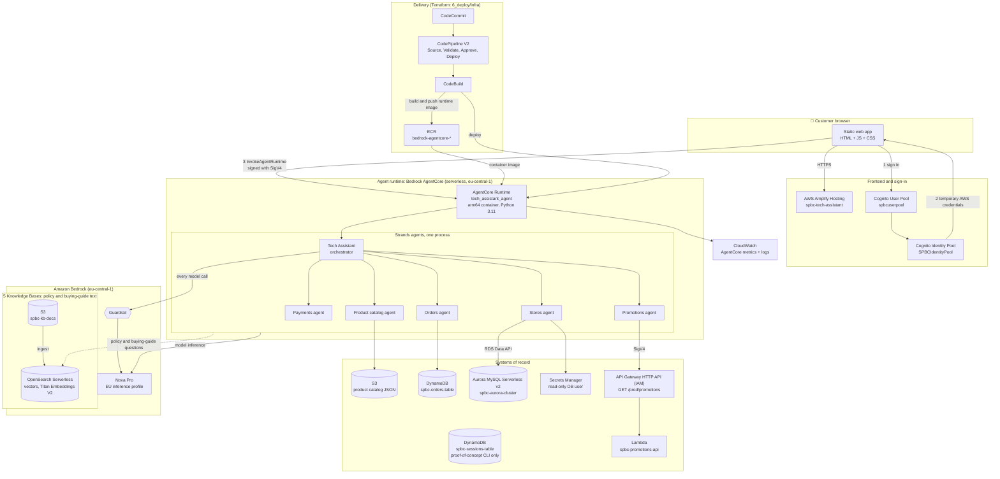
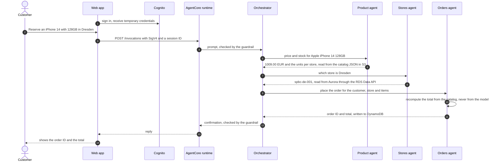
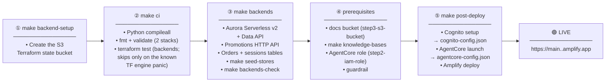
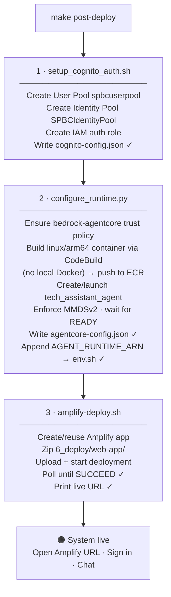

# 📱 Cyberport Tech Assistant — Production Deployment

Production AWS deployment pipeline for the **Cyberport Tech Assistant** — a multi-agent GenAI
shopping and service assistant for an electronics retailer, built on Amazon Bedrock AgentCore and
deployed to `eu-central-1` (Frankfurt).

> **Reference demo.** Not affiliated with or endorsed by Cyberport. The smartphone and
> laptop catalog comes from public Kaggle datasets (PcComponentes prices in €, Apache 2.0); stores,
> stock, orders, promotions and policies are illustrative. See
> [2_data_strategy/SOURCES.md](2_data_strategy/SOURCES.md).

## What it does

One orchestrator (the Tech Assistant) routes each customer question to five specialist agents, each
reading its own system of record:

| Agent | Answers | System of record |
|---|---|---|
| Product catalog | Specs, comparisons, recommendations, prices per storage size, stock per store | Catalog JSON in S3 + buying-guide KB |
| Orders | Click & collect orders, order status (needs customer ID **and** order ID), delivery, returns, warranty | DynamoDB `spbc-orders-table` + orders KB |
| Payments | Payment methods, 0% financing, refunds, invoices, gift cards | Payments KB |
| Stores | Locations, opening hours, pickup stations, repair desk, recycling | Aurora `StoresDB.stores` (read-only) + stores KB |
| Promotions | Trade-in bonus, student and business discounts, Black Friday | Promotions API (IAM) + promotions KB |

Example questions:

```
Catalog   → "Which laptop under €1,000 is best for a student?"
Stock     → "Is the Apple iPhone 14 in stock at the Cyberport Store Dresden?"
Orders    → "What is the status of order ord_2055_023 for customer_2055?"
Payments  → "Can I pay for a laptop in instalments?"
Stores    → "What are the opening hours in Berlin?"
Promos    → "How does the trade-in bonus work?"
```

Order totals are always recomputed from the catalog inside `place_order`, never taken from the
model, and order lookups require both the customer ID and the order ID.

---

## Technology stack

| Layer | Technology | Notes |
|---|---|---|
| Frontend | Static HTML, CSS and JavaScript, no build step | `6_deploy/web-app`; hosted on **AWS Amplify**. Libraries come from a CDN: `amazon-cognito-identity-js` 6.3.7 and AWS SDK for JavaScript 2.1563.0 |
| Sign-in | **Amazon Cognito** user pool + identity pool | The browser exchanges the sign-in for temporary AWS credentials and signs each request with SigV4 |
| Agent runtime | **Amazon Bedrock AgentCore Runtime** | One linux/arm64 container (`python:3.11-slim`), built on CodeBuild with `bedrock-agentcore-starter-toolkit` 0.3.14; the runtime requires MMDSv2 |
| Agent framework | **Strands Agents** 1.62.0, `strands-agents-tools` 0.8.10, `bedrock-agentcore` 1.24.2 | "Agents as tools": one orchestrator calls five specialist agents as in-process tools |
| Model | **Amazon Nova Pro** through the EU inference profile `eu.amazon.nova-pro-v1:0` | The bare model ID cannot be invoked on-demand in eu-central-1 |
| Retrieval | **Bedrock Knowledge Bases** (5) on **OpenSearch Serverless** | Titan Text Embeddings V2 (1024 dimensions), HNSW/faiss index, hybrid search returning 7 results; source documents in S3 |
| Data | **DynamoDB** (orders, sessions), **Aurora MySQL Serverless v2** (stores), **S3** (catalog JSON, KB documents) | Aurora is read through the **RDS Data API** with a SELECT-only user (no VPC path from the runtime) |
| Business API | **API Gateway HTTP API** (IAM auth) + **Lambda** (Python 3.12, arm64) | Serves today's promotions; the promotions agent calls it with SigV4 |
| Safety | **Bedrock Guardrails**, IAM least privilege, **Secrets Manager**, **SSM Parameter Store** | Content filters including prompt-attack detection, denied topics, PII masking and blocking; the guardrail ID and version live in SSM |
| Infrastructure as code | **Terraform** `>= 1.10`, AWS provider `~> 5.100` | Two stacks (`agentcore-backends`, `codepipeline`), remote state in S3 with a lock file |
| Service setup | Bash and Python scripts | Knowledge bases, guardrail, AgentCore runtime, Cognito and Amplify are created by idempotent scripts, not Terraform |
| CI/CD | **CodeCommit**, **CodePipeline** V2, **CodeBuild** (`amazonlinux2-x86_64-standard:5.0`) | Source, Validate (`make ci`), manual Approve, Deploy |
| Observability | **CloudWatch** generative AI observability and Logs | AgentCore publishes runtime metrics (`AWS/Bedrock-AgentCore`) and logs without extra code |
| Data and analysis tooling | Python, `pandas` (catalog builder), **Streamlit** (value model) | `pip install pandas` to run `2_data_strategy/build_from_kaggle.py`; it is not part of the runtime |

---

## Architecture



The dashed line is the knowledge-base lookup. Every specialist can use it, but only for policy and
buying-guide questions, after the live data tools have been tried.

### One request, end to end

A click & collect order, from the first message to the confirmation:



### Design decisions

- **One runtime, six agents.** The specialists are tools inside one process, so agent-to-agent calls are function calls, not network hops, and there is a single container to build, version and scale.
- **No server between the browser and the agents.** The page is static; the browser holds temporary Cognito credentials and calls AgentCore directly, so there is no API layer to run or secure.
- **Facts come from data, language comes from the model.** Prices, stock, orders, hours and promotions are read from their systems of record by tools. Knowledge bases hold only policy and buying-guide text, so the model cannot invent a price.
- **Totals are computed in code.** `place_order` recomputes the total from the catalog and ignores any number the model supplies. Order lookups need both the customer and the order ID.
- **Aurora through the RDS Data API.** The runtime reaches the stores database over HTTPS with IAM, so it needs no VPC attachment, connection pool or database password, and it uses a SELECT-only user.
- **The promotions API is a real business API.** It sits behind IAM authorization and a Lambda function, which shows how an agent calls an existing service rather than a database.
- **Terraform for stable infrastructure, scripts for the rest.** The database, API, tables and pipeline are Terraform; knowledge bases, the guardrail and the runtime are created by idempotent scripts that can be re-run safely.
- **Human approval before production.** The pipeline pauses at a manual approval before it deploys.

---

## System components

The AWS resources and the names they are created with.

| Layer | Component | AWS Resource | Name |
|---|---|---|---|
| Frontend | Web app | AWS Amplify Hosting | `spbc-tech-assistant` |
| Auth | User Pool | Amazon Cognito | `spbcuserpool` |
| Auth | Identity Pool | Amazon Cognito | `SPBCIdentityPool` |
| Agent runtime | Orchestrator + 5 specialists (one runtime) | Bedrock AgentCore (container artifact, built by CodeBuild) | `tech_assistant_agent` |
| CI/CD | Source repository | AWS CodeCommit | `spbc-tech-assistant` |
| CI/CD | Pipeline (Source → Validate → Approve → Deploy) | AWS CodePipeline (V2) + CodeBuild | `6_deploy/infra/codepipeline` |
| Compute | Container registry | Amazon ECR | `bedrock-agentcore-*` (runtime image) |
| Data | Orders store | DynamoDB (PITR, deletion protection), `6_deploy/infra/agentcore-backends` | `spbc-orders-table` |
| Memory | Conversation turns (short-term) and per-customer preferences, facts and session summaries (long-term) | Amazon Bedrock AgentCore Memory, `6_deploy/agents/create_memory.py` (`make memory`) | `spbc_tech_assistant_memory`; runtime env `MEMORY_ID`; customer id comes from the web app's `[[CTX]] userId`, so it separates demo users but is not an authenticated identity |
| Data | Sessions store (proof-of-concept CLI only) | DynamoDB (PITR, deletion protection), `6_deploy/infra/agentcore-backends` | `spbc-sessions-table` |
| Data | Store locations | Aurora MySQL Serverless v2, read through the RDS Data API (`6_deploy/infra/agentcore-backends`) | `spbc-aurora-cluster`, read-only secret `spbc-stores-db-reader` |
| Data | Promotions API | API Gateway HTTP API (IAM auth) + Lambda (`6_deploy/infra/agentcore-backends`) | `spbcPromotionsAPI`, `GET /prod/promotions` |
| Data | KB documents and product catalog | S3 + OpenSearch Serverless | `spbc-kb-docs-<account>` |
| AI | Foundation model | Amazon Bedrock | Nova Pro via EU inference profile `eu.amazon.nova-pro-v1:0` (no in-Region on-demand in eu-central-1) |
| Security | Content guardrail | Bedrock Guardrail | `/SPBC/guardrail/*` (SSM) |
| Security | Database credentials | Secrets Manager | `spbc-stores-db-reader` (read-only user used by the agents); the RDS-managed master secret is used only by the loader |
| Observability | Runtime metrics (invocations, latency, errors, sessions) and logs | CloudWatch generative AI observability + Logs | namespace `AWS/Bedrock-AgentCore`, log groups `/aws/bedrock-agentcore/runtimes/<runtime-id>-DEFAULT` |
| IaC state | Remote state for both Terraform stacks (`agentcore-backends`, `codepipeline`), locked with an S3 lock file | S3 bucket | `spbc-tfstate-<account-id>` |

---

## Deployment pipeline



---

## First-time deployment

### Step 1 — Backend setup *(run once)*

Creates the S3 bucket that holds the Terraform state of the two stacks (versioned, encrypted,
not public). Both stacks lock their state with an S3 lock file, so the bucket is all they need.

```bash
make backend-setup
```

### Step 2 — Local validation

```bash
make ci
```

Runs `python3 -m compileall` on the Python code and `terraform fmt -check` (tracked files only) +
`terraform validate` on both Terraform stacks — `agentcore-backends` and `codepipeline` — plus the mocked `terraform test` suite of `6_deploy/infra/agentcore-backends`
(no AWS calls).

> **Known limitation — `terraform test`:** the installed Terraform (1.16.x and 1.17.0) hits an
> engine bug that **panics** marshalling a marked/sensitive value to JSON while rendering a test
> diagnostic (`value has marks, so it cannot be serialized as JSON`). `ci_checks.sh` detects that
> **exact panic signature** and prints a visible `WARNING: SKIPPING 'terraform test'` instead of
> failing the whole suite — `fmt` + `validate` for that stack are still enforced, and any *other*
> non-zero exit (a real assertion failure) still fails CI. This is the only permitted skip; it is
> clearly labelled in the output. The stack configuration itself is valid.

### Step 3 — AgentCore backends *(stores database, promotions API, orders and sessions tables)*

A separate Terraform stack, [6_deploy/infra/agentcore-backends](6_deploy/infra/agentcore-backends), with its own
state (`prod/agentcore-backends.tfstate`). It needs Terraform 1.10+.

```bash
make backends                    # plan → confirm → apply exactly that plan
make seed-stores                 # create StoresDB.stores, load 2_data_strategy/stores, create the read-only user
make backends-check              # reader query, unsigned request rejected (403), signed GET /promotions
eval "$(make -s backends-env)"   # STORES_DB_* + PROMOS_API_URL for configure_runtime.py (setup_env.sh discovers them too)
```

| Resource | Detail |
|---|---|
| Aurora MySQL Serverless v2 | `spbc-aurora-cluster`, 2 instances (Multi-AZ), 0.5–4 ACU, encrypted, TLS required, 7-day backups, deletion protection, final snapshot, RDS Data API |
| Credentials | RDS-managed master secret (loader only); read-only `stores_reader` in `spbc-stores-db-reader` (agents) |
| Network | Isolated VPC (private subnets, no IGW/NAT, flow logs); no inbound rule on the database |
| Promotions API | HTTP API `spbcPromotionsAPI`, `GET /promotions` with IAM auth, stage `prod` (throttled, access logs) → Lambda serving today's promotions from `2_data_strategy/promos/promos_records.json` |
| Orders and sessions tables | `spbc-orders-table` (read and written by the orders agent) and `spbc-sessions-table` (proof-of-concept CLI only); on-demand billing, point-in-time recovery, encryption, deletion protection |
| Outputs | `agentcore_runtime_env` (the 4 runtime env vars), `agentcore_runtime_backends_policy_json` (execution-role policy) |

Settings live in `6_deploy/infra/agentcore-backends/terraform.tfvars` (see `terraform.tfvars.example`), for example
`aurora_instance_count = 1` and `aurora_min_acu = 0` (auto-pause) for non-production. `configure_runtime.py` passes the
four env vars to the runtime and attaches the `SPBC-AgentCore-Backends` inline policy to its execution role.

Then run `source setup_env.sh`: it writes the four values into `~/environment/env.sh`, which `make post-deploy` loads.
`make post-deploy` skips the AgentCore launch when `agentcore-config.json` already holds a runtime ARN, so for an
existing runtime apply the new settings with `cd 6_deploy/agents && python3 configure_runtime.py`.

### Step 4 — Knowledge bases + the clean-account prerequisites

On a **clean account** (or after a full teardown) these prerequisites must exist before the
knowledge bases and the runtime launch — both verified during the live eu-central-1 deploy:

```bash
# (a) KB documents bucket — bootstrap_vector_store.sh REQUIRES it to already exist.
#     Creates spbc-kb-docs-<account> and uploads the electronics_<domain>/ FAQ docs + menu_records.json.
./deploy_agentcore.sh step3-s3-bucket
source setup_env.sh                  # re-discover so S3_BUCKET_NAME / OPENSEARCH_S3_BUCKET_ARN are set

# (b) Vector store + all five knowledge bases (creates the OpenSearch Serverless
#     collection — the dominant ~$350/mo cost). Each sync is verified non-zero.
source ~/environment/env.sh          # make knowledge-bases needs the bucket vars in its env
make knowledge-bases
source setup_env.sh                  # pick up the five new KB IDs

# (c) AgentCore execution role — configure_runtime.py resolves SPBC-AgentCore-ExecutionRole
#     by name; without it, it falls back to a CloudFormation stack that does not exist and fails.
./deploy_agentcore.sh step2-iam-role

# (d) Bedrock Guardrail — without it the runtime runs with no content filter. The script stores
#     the ID and version in SSM (/SPBC/guardrail/*); setup_env.sh exports them for post-deploy.
bash 5_security_rai/create_and_store_guardrail.sh
source setup_env.sh
```

> **Why these are separate steps.** `make knowledge-bases` fails fast if the docs bucket is
> absent (it does not create it), and `make post-deploy` fails in `configure_runtime.py` if the
> execution role is absent. A teardown removes both the bucket and the role, so a fresh deploy
> must recreate them here. On an account where they already exist, these steps are safe no-ops.

### Step 5 — Post-deploy *(Cognito + AgentCore + Amplify)*

```bash
make post-deploy
```

This **single command** completes the system end-to-end — no manual steps:



The script is **idempotent** — each sub-step checks whether the config file is already
populated before re-running, so it is safe to re-run after partial failures.

> **Runtime artifact type.** The canonical runtime is a **container** built by CodeBuild;
> `deploy_agentcore.sh` now defaults `ARTIFACT_TYPE=container` to match. A `zip` (direct-code)
> runtime is still available as a Docker-free fallback via `ARTIFACT_TYPE=zip`, but do not mix the
> two on the same runtime name — AWS cannot change an existing runtime's artifact type, so switching
> requires deleting the runtime first (`deploy_agentcore.sh teardown`).

---

## Unattended deployment

Every step below runs without a terminal: nothing prompts, and each stage fails loudly rather
than skipping work or guessing a value.

```bash
# 1. Terraform state bucket, then validation
make backend-setup
make ci

# 2. Data backends and knowledge bases
AUTO_APPROVE=1 make backends         # Aurora, promotions API, DynamoDB tables; applies the reviewed plan
make seed-stores
make backends-check
./deploy_agentcore.sh step3-s3-bucket   # clean-account prereq: KB docs bucket (make knowledge-bases needs it)
source setup_env.sh                  # discovers buckets, KBs, STORES_DB_*, PROMOS_API_URL
source ~/environment/env.sh          # make knowledge-bases reads the bucket vars from its env
make knowledge-bases                 # vector store + all five KBs, each sync verified
source setup_env.sh                  # pick up the five new KB IDs

# 3. Cognito, AgentCore runtime, frontend
./deploy_agentcore.sh step2-iam-role    # clean-account prereq: SPBC-AgentCore-ExecutionRole (configure_runtime.py needs it)
bash 5_security_rai/create_and_store_guardrail.sh && source setup_env.sh   # guardrail ID/version → env.sh
export COGNITO_ADMIN_USERNAME=demo
export COGNITO_ADMIN_PASSWORD_SECRET_ID=spbc/cognito-admin   # or --skip-user; create this secret first on a clean account
make post-deploy-force               # --force: plain post-deploy skips the launch when a runtime exists

# 4. Verify
SMOKE_TEST_URL=https://main.<app-id>.amplifyapp.com make smoke
./deploy_agentcore.sh step9-test-runtime   # asserts each domain's answer, not just HTTP 200
```

Behaviour that matters when nobody is watching:

| Concern | How it behaves |
|---|---|
| Sign-in user | From `COGNITO_ADMIN_USERNAME` + `COGNITO_ADMIN_PASSWORD_SECRET_ID` (Secrets Manager) or `COGNITO_ADMIN_PASSWORD`; `SKIP_USER_CREATION=1` to create none. With no terminal and none of these, the script stops instead of waiting on stdin. |
| Re-deploying agent code | `make post-deploy-force` or `FORCE_REDEPLOY=1` (an existing sign-in user is kept; nothing is prompted). Without it a populated `agentcore-config.json` makes the launch a no-op, and the run says so. |
| Knowledge bases | Idempotent; an ingestion job that scans zero documents or fails one fails the run. |
| Terraform | `-input=false` everywhere; `make backends` needs `AUTO_APPROVE=1` to skip its confirmation. |
| Frontend check | `SMOKE_TEST_URL` is required and the body must contain the app's title, so a 200 from a holding page fails. |
| Agent check | `step9-test-runtime` matches each domain's answer against an expected pattern and rejects "Sorry, I encountered an error"-style replies. Domains whose backend isn't configured degrade to warnings. |

### Running it from CI

That sequence runs on AWS — CodeCommit + CodePipeline (V2) + CodeBuild, no stored AWS keys and
no account IDs in the pipeline. The source lives in a CodeCommit repo; a push to `main` drives
the pipeline through four stages: **Source → Validate → Approve → Deploy**. Validate runs
`make ci`; Deploy runs [6_deploy/codepipeline/buildspec-deploy.yml](6_deploy/codepipeline/buildspec-deploy.yml),
which maps the deploy steps onto the same scripts. The stack and operator walkthrough live in
[6_deploy/infra/codepipeline/README.md](6_deploy/infra/codepipeline/README.md).

The slow, billable stages stay opt-in as pipeline variables, surfaced to the Deploy build as
CodeBuild environment variables:

| Toggle | Default | Purpose |
|---|---|---|
| `TOGGLE_PROVISION_BACKENDS` | `false` | Apply and seed the data backends (database, promotions API, DynamoDB tables) |
| `TOGGLE_SETUP_KNOWLEDGE_BASES` | `false` | Bootstrap the vector store and knowledge bases |
| `TOGGLE_DEPLOY_AGENT` | `true` | Deploy the AgentCore runtime + frontend |
| `TOGGLE_SMOKE` | `false` | Run the frontend smoke test (only when `SMOKE_TEST_URL` is also set) |

`COGNITO_ADMIN_USERNAME` + `COGNITO_ADMIN_PASSWORD_SECRET_ID` create the sign-in user; without
both the Deploy build passes `--skip-user`. The **Approve** stage is a manual approval action
that pauses the pipeline and notifies the `spbc-pipeline-approvals` SNS topic — approve from the
console or with `aws codepipeline put-approval-result`.

---

## Day-2 operations

| Command | When to use |
|---|---|
| `make amplify` | Re-deploy only the frontend after UI changes |
| `make post-deploy` | Re-run Cognito / AgentCore / Amplify after any config change. Creates the AgentCore Memory first when missing (a failure there only logs a warning) |
| `make memory` | Create the AgentCore Memory on its own (idempotent); `setup_env.sh` then exports `MEMORY_ID` |
| `make smoke` | Verify the live endpoint (set `SMOKE_TEST_URL` env var first) |
| `make backends-plan` / `make backends` | Review and apply backend changes (for example after editing `promos_records.json`: the Lambda function is rebuilt) |
| `make seed-stores` | Reload the stores data, or re-sync `stores_reader` after rotating its secret (idempotent) |
| `make backends-check` | Prove the stores database and promotions API answer the way the runtime calls them |
| `make knowledge-bases` | Create or re-sync the vector store and all five knowledge bases (idempotent) |
| `bash 3_proof_of_concept/knowledge_bases/setup_knowledge_bases.sh <domain>` | Re-sync one knowledge base after editing its source document |
| `make post-deploy-force` | Ship changed agent code (plain `post-deploy` skips the launch when a runtime already exists) |
| `make help` | Print all available targets with descriptions |

---

## Repository layout

```
.
├── 1_business_modeling/        Business value model (EUR)
├── 2_data_strategy/            Seed data — product catalog (Kaggle), stores, orders, promos
│   ├── build_from_kaggle.py     Rebuilds the catalog and orders from the Kaggle datasets
│   ├── SOURCES.md               Data sources, licences, and which data is illustrative
│   └── stores/load_stores_data_api.py   Stores loader through the RDS Data API (make seed-stores)
├── 3_proof_of_concept/         PoC agents + knowledge-base setup scripts
│   └── knowledge_bases/
│       ├── bootstrap_vector_store.sh    OpenSearch Serverless collection, policies, KB service role
│       ├── setup_knowledge_bases.sh     All five KBs, idempotent, each sync verified
│       ├── kb_common.sh                 Shared helpers used by the above
│       └── <domain>_knowledge_base_setup.sh   Per-domain scripts (menu, orders, payments, stores, promos)
├── 4_monitor_and_evaluate/     CloudWatch observability scripts
├── 5_security_rai/             Bedrock Guardrail creation + SSM storage
├── 6_deploy/
│   ├── agents/                 Production agent code (Strands + AgentCore)
│   │   ├── tech_assistant_agent.py         Tech Assistant orchestrator (entrypoint)
│   │   ├── menu_agents.py                 Product catalog agent (get_menu, pricing, store stock)
│   │   ├── orders_agents.py
│   │   ├── payments_policy_agents.py
│   │   ├── stores_agents.py
│   │   ├── promos_agents.py
│   │   ├── place_order.py
│   │   ├── configure_runtime.py          Builds the container via CodeBuild, launches AgentCore, writes configs
│   │   ├── Dockerfile                    linux/arm64 runtime image (built by CodeBuild)
│   │   ├── requirements.txt              Pinned runtime dependencies (shipped to AgentCore)
│   │   └── requirements-deploy.txt       + starter toolkit, for running configure_runtime.py
│   ├── infra/agentcore-backends/  Terraform: Aurora stores DB (Data API), promotions API, orders + sessions DynamoDB tables
│   │   ├── lambda/promotions/handler.py  GET /promotions (today's promotions)
│   │   └── tests/backends.tftest.hcl     Mocked plan/apply tests (terraform test)
│   ├── infra/codepipeline/     Terraform: CodeCommit + CodePipeline + CodeBuild (the all-AWS CI/CD) + README
│   ├── codepipeline/           CI/CD buildspecs
│   │   ├── buildspec-ci.yml              Validate stage → make ci
│   │   └── buildspec-deploy.yml          Deploy stage → the phased deploy, gated by TOGGLE_* vars
│   ├── scripts/
│   │   ├── terraform_backend_setup.sh   ← Step 1 (make backend-setup)
│   │   ├── ci_checks.sh                 ← make ci
│   │   ├── agentcore_backends.sh        ← make backends / seed-stores / backends-check
│   │   ├── post_deploy.sh               ← make post-deploy (Cognito + AgentCore + Amplify)
│   │   ├── amplify-deploy.sh
│   │   ├── setup_cognito_auth.sh
│   │   └── smoke_test.sh
│   └── web-app/                Static frontend (index/login HTML, *-enhanced.js, cognito-enhanced.js,
│                               agentcore-client-fixed.js, style + enhanced CSS, hero-devices.svg)
├── amplify.yml                 Amplify build spec
├── Makefile                    All deployment targets
├── setup_env.sh                Discovers + exports AWS resource IDs
└── check_env.sh                Validates environment before deploy
```

---

## Pre-deploy checklist

Before running `make backends` for the first time, verify:

- [ ] `aws sts get-caller-identity` succeeds with the correct account
- [ ] The Python environment is set up and **active in the terminal you deploy from**. Use a virtualenv: Homebrew's Python refuses global `pip install` (PEP 668), and the root `requirements.txt` would install AWS CLI v1 over your v2. The deploy scripts need `boto3`, the AgentCore starter toolkit and `awscurl` (used for the knowledge-base indexes):
  ```bash
  python3 -m venv .venv                # .venv/ is gitignored
  source .venv/bin/activate            # repeat in every new terminal
  pip install -r 6_deploy/agents/requirements-deploy.txt awscurl
  ```
- [ ] `make backend-setup` has been run (creates the Terraform state bucket)
- [ ] Nova Pro answers through the EU inference profile (listing foundation models isn't enough — the bare `amazon.nova-pro-v1:0` ID can't be invoked on-demand in eu-central-1):
  `aws bedrock-runtime converse --region eu-central-1 --model-id eu.amazon.nova-pro-v1:0 --messages '[{"role":"user","content":[{"text":"Reply with OK"}]}]'`
- [ ] `make backends-check` passes and `STORES_DB_CLUSTER_ARN`, `STORES_DB_SECRET_ARN`, `PROMOS_API_URL` are exported (after Step 3)
- [ ] **Clean-account prereq:** KB docs bucket exists (`./deploy_agentcore.sh step3-s3-bucket`) **before** `make knowledge-bases` — it does not create the bucket itself
- [ ] `make knowledge-bases` has been run and the five KB IDs are in `~/environment/env.sh` (required by `configure_runtime.py`)
- [ ] **Clean-account prereq:** the AgentCore execution role exists (`./deploy_agentcore.sh step2-iam-role`) **before** `make post-deploy` — `configure_runtime.py` resolves `SPBC-AgentCore-ExecutionRole` by name
- [ ] The guardrail exists and `GUARDRAIL_ID` / `GUARDRAIL_VERSION` are in `~/environment/env.sh` (`bash 5_security_rai/create_and_store_guardrail.sh`, then `source setup_env.sh`) — otherwise the runtime runs without one

---

## Notes

- **Region:** `eu-central-1` (Frankfurt) — all resources
- **Currency:** all prices in Euros (€)
- **Secrets:** `terraform.tfvars`, `cognito-config.json`, `agentcore-config.json` are gitignored — never commit them
- **Stores DB access:** the agents use the RDS Data API with a SELECT-only user, so the AgentCore runtime needs no VPC path to Aurora; the master secret is only used by the loader
- **Promotions API:** IAM-authorized (SigV4); unsigned requests get 403. Edit `2_data_strategy/promos/promos_records.json` and `make backends` to change promotions
- **Backends teardown:** `bash 6_deploy/scripts/agentcore_backends.sh apply -var aurora_deletion_protection=false -var dynamodb_deletion_protection=false`, then `... destroy` (guarded; keeps the database's final snapshot, but **the orders and sessions tables are deleted with their data**)
- **CI/CD is all AWS-native:** CodeCommit + CodePipeline + CodeBuild. GitHub Actions and the GitHub OIDC deploy role have been **retired** — there is no `.github/` workflow directory and no `6_deploy/infra/github-oidc` stack. See [6_deploy/infra/codepipeline/README.md](6_deploy/infra/codepipeline/README.md) to stand the pipeline up and push the repo to CodeCommit.
- **Terraform:** two independent stacks (`agentcore-backends`, `codepipeline`), each with its own state key in `spbc-tfstate-<account-id>` (derived from your account because bucket names are global; `TF_STATE_BUCKET` overrides it). `make backend-setup` must create that bucket before any `terraform init`. Tested with Terraform 1.17.0 (constraints are `>= 1.10`).

### Known limitations

- **Browser SDK:** the web app signs requests with the AWS SDK for JavaScript v2 (2.1563.0, loaded from a CDN), which reached end-of-support on 8 September 2025. Moving to SDK v3 is the next step; the two places to change are the Cognito credentials and the SigV4 signing in `agentcore-client-fixed.js`.
- **Guardrail scope:** the guardrail is attached to the orchestrator's model calls. The specialist agents' own model calls and the knowledge-base answers are not wrapped by it.
- **Order privacy:** an order lookup needs both the customer ID and the order ID, but it is not tied to the signed-in Cognito user.
- **Demo data:** product prices come from one Spanish retailer in 2023 and 2024, and stores, stock, orders and promotions are illustrative. See [2_data_strategy/SOURCES.md](2_data_strategy/SOURCES.md).
